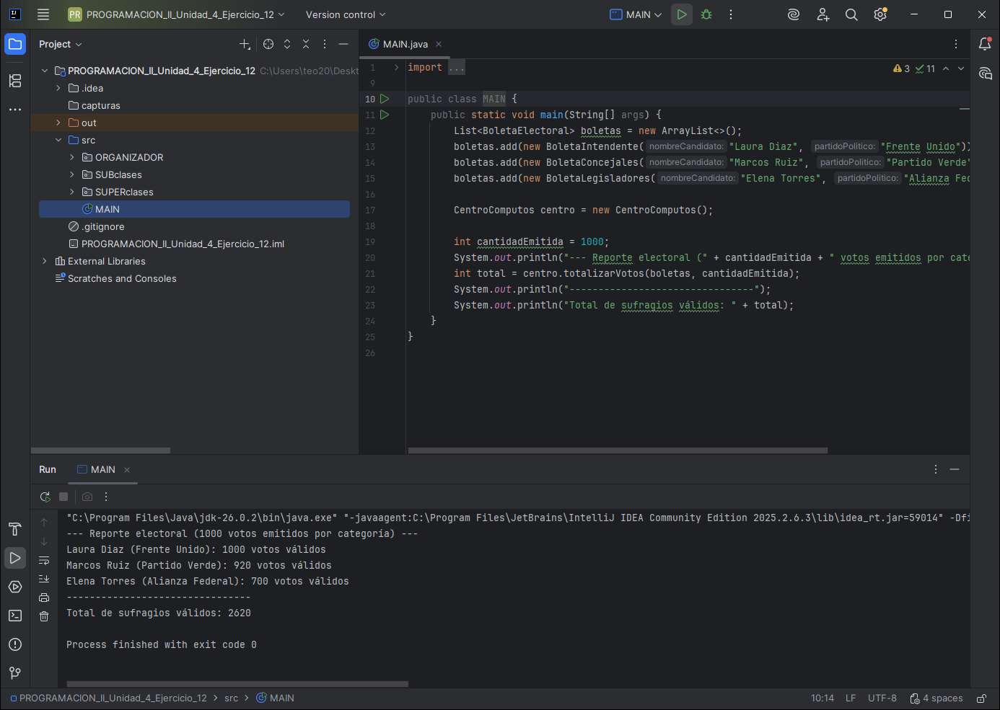

# PROGRAMACIÓN II — Unidad 4, Ejercicio 12: El Sistema de Conteo de Votos y Resultados Electorales

Trabajo práctico de Programación II. Este repositorio contiene la resolución en Java del ejercicio 12 de la Unidad 4.

## Consigna

#### Contexto

En un proceso electoral automatizado, las urnas electrónicas registran votos emitidos para diferentes tipos de cargos o categorías (candidatos a intendente, concejales y legisladores). El sistema de escrutinio procesa los cómputos de forma unificada, delegando en cada estructura de boleta la forma en que se contabilizan y validan los sufragios.

#### Consigna

Implementar un sistema modular en Java donde se utilice polimorfismo para calcular los resultados electorales de distintas categorías de votación mediante una invocación unificada.

#### Desarrollo requerido

- Definir una clase abstracta BoletaElectoral con atributos básicos como nombreCandidato y partidoPolitico, además del método abstracto int contarVoto(int cantidadEmitida).
- Crear clases hijas como BoletaIntendente, BoletaConcejales y BoletaLegisladores que sobrescriban el método de conteo aplicando restricciones de tachas o preferencias.
- Desarrollar una clase CentroComputos que procese una lista polimórfica de boletas y totalice la cantidad de sufragios válidos.
- En el método main, crear instancias de las distintas subclases, agregarlas a una colección general, invocar el conteo polimórfico y mostrar el reporte electoral por consola.

## Estructura del repositorio

```
PROGRAMACION_II_Unidad_4_Ejercicio_12/
├── README.md
├── capturas/
│   └── consola.png
└── src/
    ├── ORGANIZADOR/
    │   └── CentroComputos.java
    ├── SUBclases/
    │   ├── BoletaConcejales.java
    │   ├── BoletaIntendente.java
    │   └── BoletaLegisladores.java
    ├── SUPERclases/
    │   └── BoletaElectoral.java
    └── MAIN.java   # clase con el método main
```

## Funcionamiento y lógica

El ejercicio aplica **polimorfismo** en el escrutinio de una elección: cada tipo de boleta cuenta sus votos válidos con su propia regla. Está organizado en los paquetes `SUPERclases`, `SUBclases` y `ORGANIZADOR`.

### `SUPERclases.BoletaElectoral` (clase abstracta)

Tiene `nombreCandidato` y `partidoPolitico` (privados, con getters) y el método abstracto `int contarVoto(int cantidadEmitida)`.

### `SUBclases`

- **`BoletaIntendente`:** boleta única; todos los votos emitidos son válidos.
- **`BoletaConcejales`:** resta los votos tachados, sin bajar de 0.
- **`BoletaLegisladores`:** solo cuentan los votos que marcaron una preferencia, con el total emitido como máximo.

### `ORGANIZADOR.CentroComputos`

Su método `totalizarVotos(boletas, cantidadEmitida)` recorre las boletas, muestra los votos válidos de cada candidato y los suma.

### `MAIN`

Con **1000 votos emitidos** por categoría:

- Laura Diaz (intendente) → **1000** válidos.
- Marcos Ruiz (concejales, con 80 tachas) → **920** válidos.
- Elena Torres (legisladores, con 700 preferencias) → **700** válidos.

El total de sufragios válidos es **2620**.

## Ejecución

Captura de la consola de IntelliJ IDEA ejecutando el programa:



Salida obtenida:

```
--- Reporte electoral (1000 votos emitidos por categoría) ---
Laura Diaz (Frente Unido): 1000 votos válidos
Marcos Ruiz (Partido Verde): 920 votos válidos
Elena Torres (Alianza Federal): 700 votos válidos
--------------------------------
Total de sufragios válidos: 2620
```
